# AirBooking

A full-stack flight booking platform with an **admin approval workflow**, seat-safe booking, a simulated payment step and **real-time flight status** (AirLabs / OpenSky Network).
Built with **Django REST Framework + Simple JWT** (backend) and **React 19 + Vite** (frontend).

> Take-home assignment for YUAI Soft Solutions Pvt. Ltd. - Full Stack Engineer (React + Django/DRF).

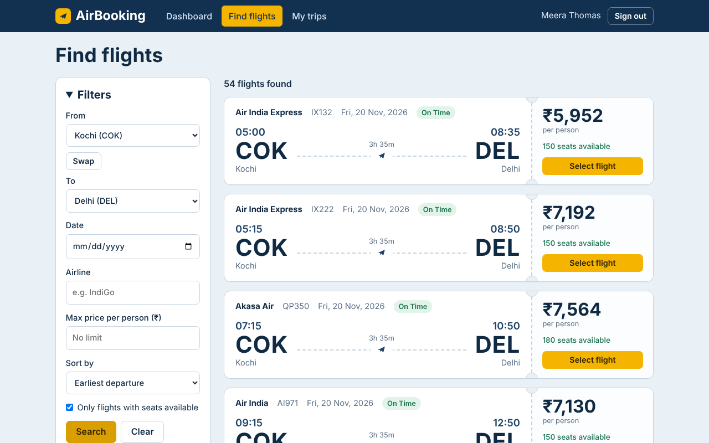

**Demo video:** [`docs/demo-video.webm`](docs/demo-video.webm) (registration, approval, search, booking, declined payment, cancellation).

## Contents
1. [Features](#features) · 2. [Additional features](#additional-features-beyond-the-brief) · 3. [Tech stack](#tech-stack) · 4. [Setup](#setup) · 5. [Test credentials](#test-credentials) · 6. [Demo walkthrough](#demo-walkthrough) · 7. [API documentation](#api-documentation) · 8. [Design decisions](#design-decisions) · 9. [Tests](#tests) · 10. [Project structure](#project-structure) · 11. [Screenshots](#screenshots)

## Features

**Accounts and approval**
- Registration with validation; the new account is created as `pending`.
- Admin reviews pending users and approves or rejects them.
- On approval a **Celery task emails the user** that the account is activated.
- Only approved users can sign in (pending and rejected users get a specific message). JWT access and refresh tokens (Simple JWT).

**Travellers**
- User dashboard: next trip, quick search, booking totals.
- Flight search filtered by **airport, date, availability**, plus airline, max price and sort order. Filters live in the URL, so searches are shareable.
- Flight details with price, seats, aircraft and **live status**.
- Booking: multiple passengers, simulated payment (card / UPI / net banking), instant confirmation with a booking reference.
- **My Trips**: upcoming, past and cancelled tabs, trip detail page (printable boarding pass), cancellation with refund.

**Admin**
- Overview dashboard: bookings, seats sold, revenue, occupancy, bookings per day, busiest routes.
- User management: pending queue, approve, reject or revoke, search and filter.
- Flight management: create, edit, delete; update status (**On time / Delayed (minutes) / Cancelled**).
- Booking monitor.

## Additional features beyond the brief
Highlighted as requested:

| Extra | Why it matters |
|---|---|
| **Overbooking-proof seat reservation** (atomic conditional `UPDATE`) | Two people booking the last seat at once can never both succeed, on any database. |
| **Approval enforced on every request**, not just at login | Revoking or rejecting a user takes effect immediately, even with a still-valid token. |
| **Booking cancellation with refund** and seats released | Complete booking lifecycle. |
| **Celery with graceful fallback** | If Redis is not running, the activation email is sent synchronously after a 0.5 s broker ping, so a reviewer without Redis can still test the flow. |
| **Live status with graceful degradation** | AirLabs, OpenSky or the airline-reported status; results cached for 60 s; provider failures never break the page. |
| Airport model and IATA-code filtering | Proper relational design instead of free-text cities. |
| Admin analytics endpoint and dashboard | Satisfies "monitor booking statistics". |
| Consistent API error shape and rate limiting (login/register 20/min, booking 30/min) | Clear UI errors and basic abuse protection. |
| Silent JWT refresh with a single shared refresh request | No surprise logouts; no refresh stampede. |
| Printable boarding-pass ticket, responsive admin tables, keyboard-accessible dialogs | UX polish. |
| Automated tests (backend) and Docker Compose for Redis and Celery | Easy to verify and run. |

## Tech stack
- **Backend:** Python 3.12, Django 5/6, Django REST Framework, Simple JWT, django-filter, django-cors-headers, Celery + Redis, SQLite (swap via settings).
- **Frontend:** React 19, React Router 7, Axios, Vite. Plain CSS (no UI kit).

## Setup

### Prerequisites
Python 3.10+, Node 18+. Redis is **optional** (only for Celery; see below).

### 1. Backend
```bash
cd backend
python -m venv .venv
source .venv/bin/activate          # Windows: .venv\Scripts\activate
pip install -r requirements.txt
cp .env.example .env               # Windows: copy .env.example .env
python manage.py migrate
python manage.py seed_demo         # airports, ~500 flights over 14 days, demo accounts
python manage.py runserver         # http://localhost:8000
```

### 2. Frontend
```bash
cd frontend
npm install
cp .env.example .env               # VITE_API_URL=http://localhost:8000/api
npm run dev                        # http://localhost:5173
```

### 3. Celery worker for approval emails (optional)
```bash
# start Redis (e.g. `docker run -p 6379:6379 redis:7-alpine`), then:
cd backend && celery -A config worker -l info
```
Without Redis the backend logs a warning and sends the email inline, so the approval flow still works. By default emails are **printed in the `runserver` terminal** (console backend). For real email set `EMAIL_BACKEND`, `EMAIL_HOST_USER`, `EMAIL_HOST_PASSWORD` in `.env`.

### Docker alternative (Redis + backend + worker)
```bash
docker compose up --build
```
Then run the frontend with `npm run dev` as above. *(This compose file was written for convenience; the manual setup above is the path I tested end to end.)*

### Environment variables (`backend/.env`)
| Variable | Purpose |
|---|---|
| `DJANGO_SECRET_KEY`, `DJANGO_DEBUG`, `DJANGO_ALLOWED_HOSTS` | Standard Django settings. Use a real secret and `DEBUG=False` in production. |
| `CORS_ALLOWED_ORIGINS` | Comma-separated frontend origins allowed by CORS. |
| `CELERY_BROKER_URL` | Redis URL, default `redis://localhost:6379/0`. |
| `EMAIL_*`, `DEFAULT_FROM_EMAIL` | Email delivery. |
| `AIRLABS_API_KEY` | Optional. Enables live tracking by flight number (AirLabs). |
| `OPENSKY_USERNAME`, `OPENSKY_PASSWORD` | Optional OpenSky credentials (anonymous access works with lower limits). |
| `FRONTEND_URL` | Used for the sign-in link in the activation email. |

### Enabling real live tracking
Seeded flights use fictional flight numbers, so they show the airline-reported status. To see live positions:
- **AirLabs:** set `AIRLABS_API_KEY` and create a flight in the admin UI using a real, currently airborne IATA flight number (e.g. one from airlabs.co).
- **OpenSky (no key needed):** edit a flight in the admin UI and set **ICAO24** to the hex transponder code of an airborne aircraft (find one on opensky-network.org). The flight page then shows latitude, longitude, altitude, speed and heading.

## Test credentials
Created by `python manage.py seed_demo`:

| Role | Email | Password |
|---|---|---|
| **Admin** | `admin@airbooking.com` | `Admin@12345` |
| Traveller (approved) | `traveller@airbooking.com` | `User@12345` |
| Traveller (pending approval) | `pending.user@airbooking.com` | `User@12345` |

Django's own admin is at `/django-admin/` (same admin account).

## Demo walkthrough
1. Register a new account at `/register`. It is created as *pending*.
2. Try to sign in. You'll see that the account is awaiting approval.
3. Sign in as admin, open **Users**, approve the account. The activation email appears in the backend terminal.
4. Sign in as the new user, **Find flights** (e.g. COK to DEL), select one.
5. Add passengers and pay. **Test card behaviour:** any valid-looking number is approved; a card **ending in `0002` is declined**; a UPI ID starting with `fail` is declined.
6. Open **My trips**, view the boarding pass and flight status, cancel a booking (seats are released and the booking is refunded).
7. As admin, change a flight to *Delayed* and watch the status update on the traveller's flight page.

## API documentation
Base URL `http://localhost:8000/api`. Send `Authorization: Bearer <access>` on authenticated routes. Lists are paginated (`count`, `next`, `previous`, `results`, 20 per page). Errors always look like `{"detail": "readable message", "errors": {field: [...]}}`.

### Authentication
| Method | Endpoint | Description | Access |
|---|---|---|---|
| POST | `/auth/register/` | Register (`email, first_name, last_name, phone?, password, confirm_password`). Creates a *pending* user. | Public |
| POST | `/auth/login/` | `{email, password}` returns `{access, refresh, user}`. 401 with a specific message if pending or rejected. | Public |
| POST | `/auth/token/refresh/` | `{refresh}` returns a new `access` (and rotated `refresh`). | Public (needs refresh token) |
| GET | `/auth/me/` | Current user. | Authenticated |

### Flights
| Method | Endpoint | Description | Access |
|---|---|---|---|
| GET | `/flights/search/` | Upcoming flights. Query: `origin`, `destination` (IATA), `date` (YYYY-MM-DD), `available_only`, `min_seats`, `airline`, `min_price`, `max_price`, `status`, `ordering` (`departure_time`, `price`, `arrival_time`, prefix `-` to reverse), `page`. | Authenticated |
| GET | `/flights/{id}/` | Flight details. | Authenticated |
| GET | `/flights/{id}/live-status/` | Live position and status (AirLabs, OpenSky or airline-reported). Cached 60 s. | Authenticated |
| GET | `/flights/airports/` | Airport list for dropdowns. | Authenticated |

### Bookings (always scoped to the current user)
| Method | Endpoint | Description | Access |
|---|---|---|---|
| POST | `/bookings/` | Create a booking and run the simulated payment. | Authenticated |
| GET | `/bookings/` | My bookings. Filters: `status`, `upcoming=true`. | Authenticated |
| GET | `/bookings/{id}/` | Booking details. 404 for other users' bookings. | Authenticated |
| POST | `/bookings/{id}/cancel/` | Cancel, refund and release seats. | Authenticated |

Create booking body:
```json
{
  "flight": 12,
  "passengers": [{"name": "Asha Nair", "age": 29}, {"name": "Rohan Nair", "age": 31}],
  "payment": {"method": "card", "card_number": "4242424242424242"}
}
```
`payment.method` is `card` (needs `card_number`), `upi` (needs `upi_id`) or `netbanking`. Seats = number of passengers (max 9). Responses: `201` booking, `400` validation or sold out, `402` payment declined.

### Admin (approved staff only; 403 otherwise)
| Method | Endpoint | Description |
|---|---|---|
| GET | `/admin/users/pending/` | Pending registrations. |
| GET | `/admin/users/` | All users. Query: `approval_status`, `search`. |
| POST | `/admin/users/{id}/approve/` | Approve and queue the activation email. |
| POST | `/admin/users/{id}/reject/` | Reject or revoke. |
| GET | `/admin/flights/` | Flights (all, including past). Same filters as search. |
| POST | `/admin/flights/` | Create flight (`origin_code`, `destination_code`, times, `price`, `total_seats`, ...). |
| PATCH/PUT/DELETE | `/admin/flights/{id}/` | Edit or delete. Delete is blocked (409) if confirmed bookings exist. |
| PUT | `/admin/flights/{id}/status/` | `{"status": "delayed", "delay_minutes": 45}`. Status is `on_time`, `delayed` or `cancelled`. |
| GET | `/admin/bookings/` | All bookings. Query: `status`, `flight`. |
| GET | `/admin/stats/` | Dashboard metrics. |

Quick check with curl:
```bash
TOKEN=$(curl -s -X POST localhost:8000/api/auth/login/ -H 'Content-Type: application/json' \
  -d '{"email":"traveller@airbooking.com","password":"User@12345"}' | python -c "import sys,json;print(json.load(sys.stdin)['access'])")
curl -s "localhost:8000/api/flights/search/?origin=COK&destination=DEL" -H "Authorization: Bearer $TOKEN"
```

## Design decisions
- **Custom user model with email login.** `approval_status` (pending, approved, rejected) with `approved_by` and `approved_at` for an audit trail. Staff or approval fields can't be set through registration.
- **Approval is checked in the authentication class**, so a revoked user's existing tokens stop working immediately.
- **Seat safety.** Reservation is one atomic `UPDATE ... WHERE available_seats >= n`; if no row is updated the request fails cleanly. Payment runs first inside the transaction, so a declined payment never holds seats. Cancellation locks the booking row and restores seats with an `F()` expression.
- **No IDOR.** Booking querysets are filtered by the requesting user; other users' IDs return 404.
- **Payment is simulated** and no card data is stored; only method and a generated reference are kept.
- **Live status runs on the server**, so API keys never reach the browser, responses are cached and failures degrade to the airline-reported status.
- **Frontend state.** `AuthContext` (tokens, session restore, role) and `TripsContext` (reducer-based booking state shared by dashboard, My Trips and detail pages). Filters are URL state. An Axios interceptor attaches the token and refreshes it once on 401.
- **Money** is stored as `Decimal`; totals are computed on the server.

## Tests
```bash
cd backend && python manage.py test
```
17 tests cover the approval workflow (pending login blocked, approval email, self-escalation attempts, revoked tokens), authorization, search filters, admin flight CRUD and status validation, booking and pricing, declined payments, overbooking, cancellation and refunds, booking isolation between users and admin statistics. The UI flow was also exercised end to end in a real browser (register, approve, search, book, decline, cancel, mobile layout).

## Project structure
```
backend/
  config/          settings, urls, celery app, API error handler
  accounts/        user model, JWT auth, approval views, Celery task
  flights/         Airport and Flight models, search, live-status service, admin API, seed command
  bookings/        Booking model, payment simulation, booking service, stats
frontend/src/
  api/             Axios client with JWT refresh
  context/         AuthContext, TripsContext
  components/      Layout, FlightTicket, BoardingPass, LiveStatus, shared UI
  pages/           traveller pages;  pages/admin/  admin pages
docs/screenshots/  application screenshots
```

## Screenshots
| | |
|---|---|
| 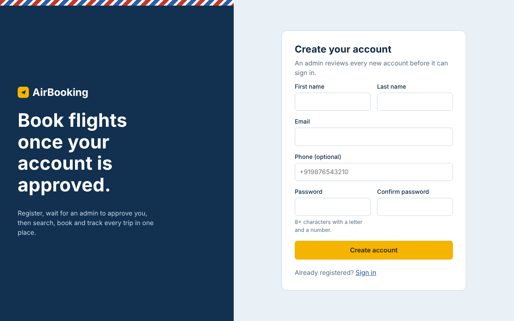 | 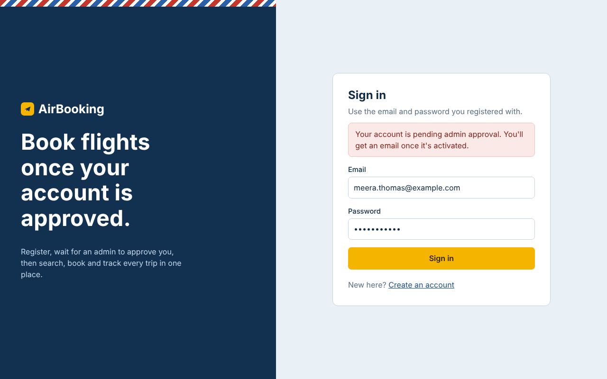 |
| 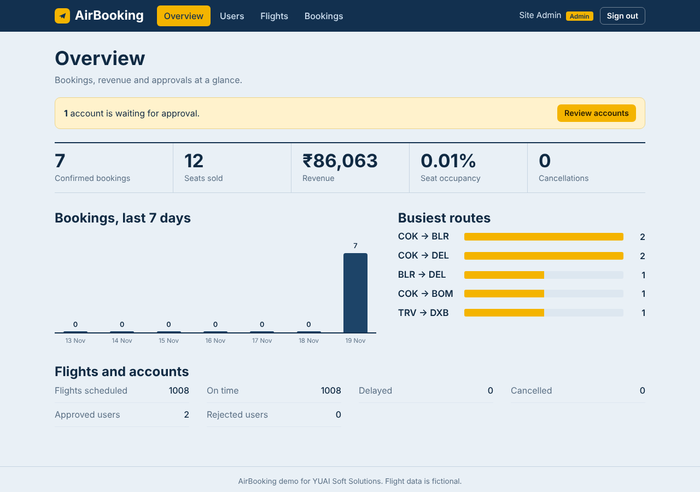 | 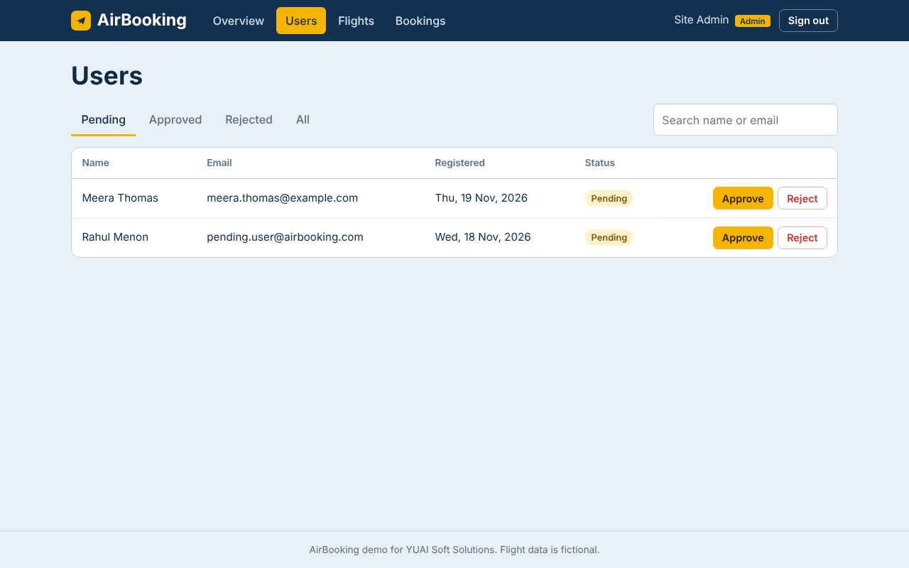 |
| 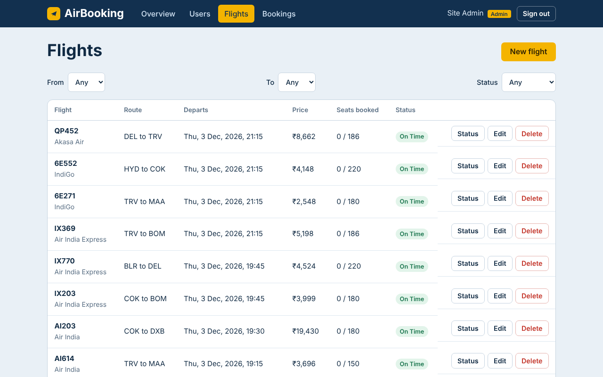 | 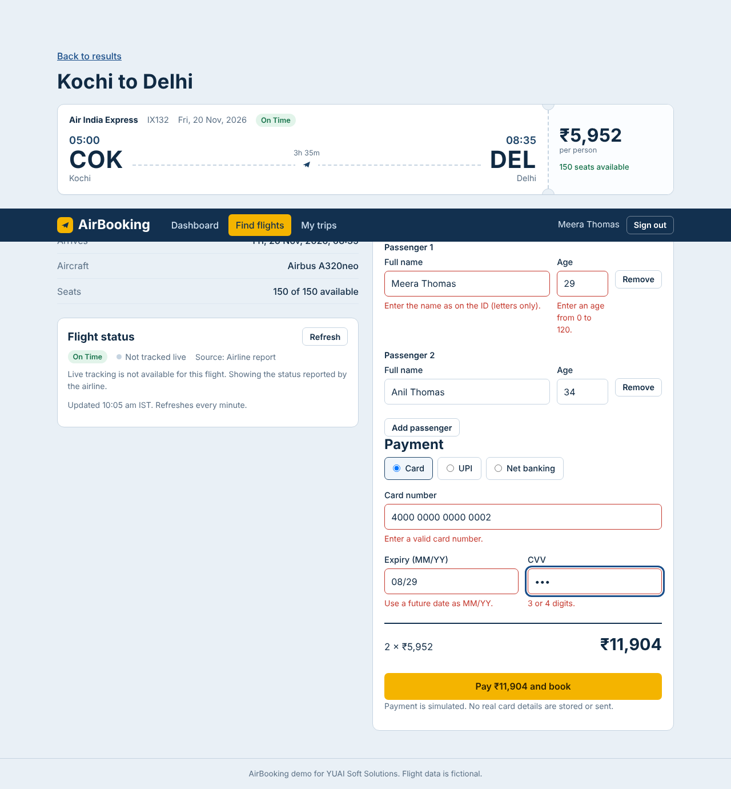 |
| 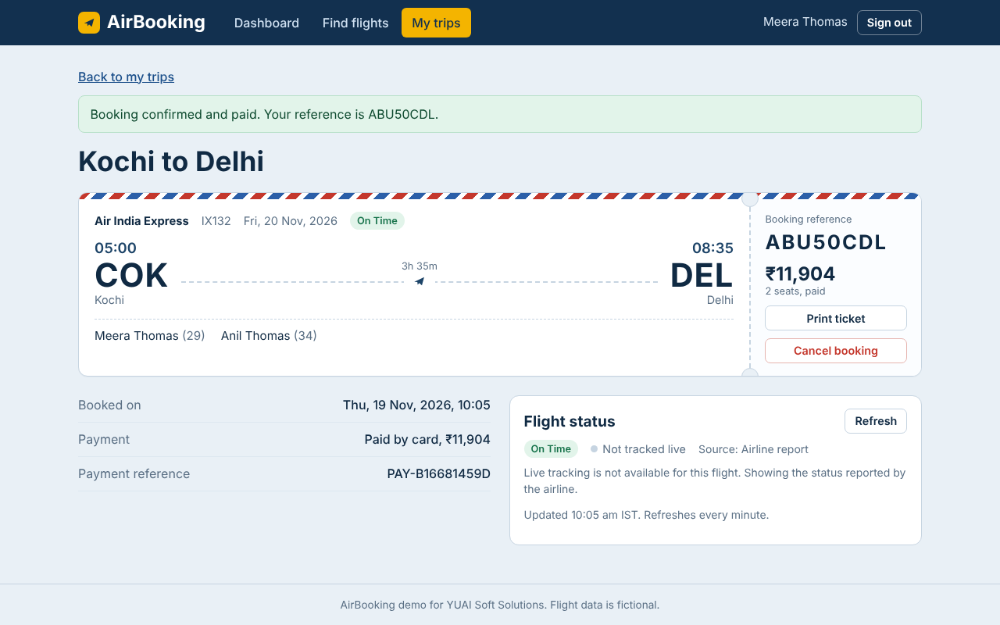 | 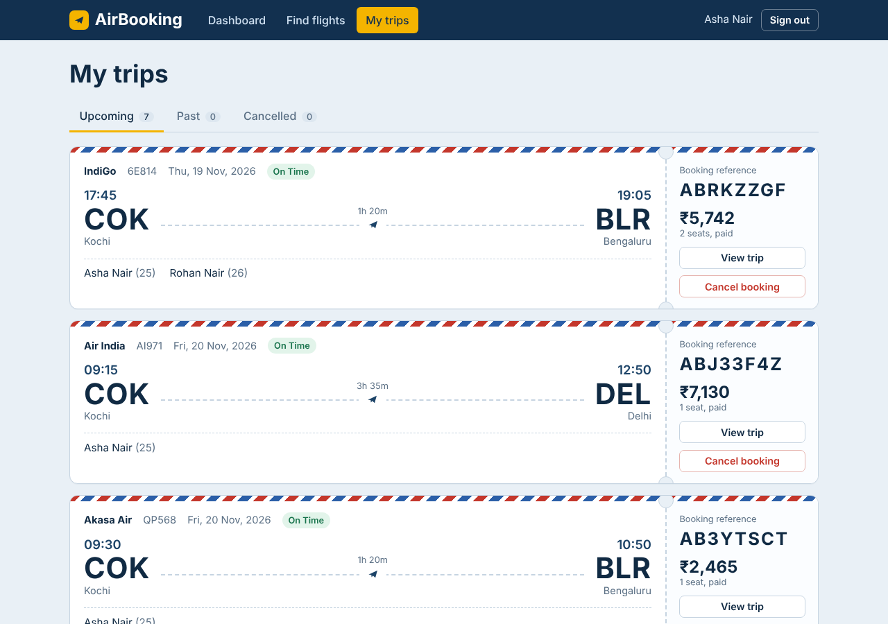 |
| 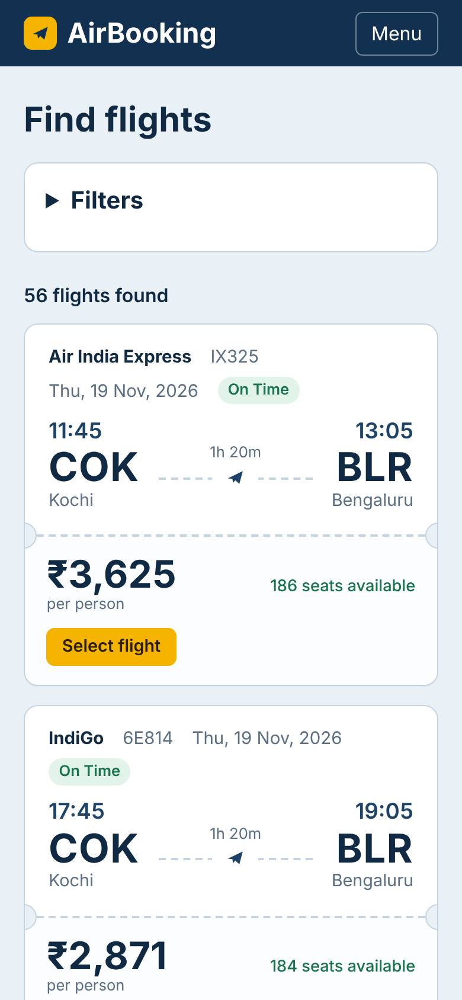 | 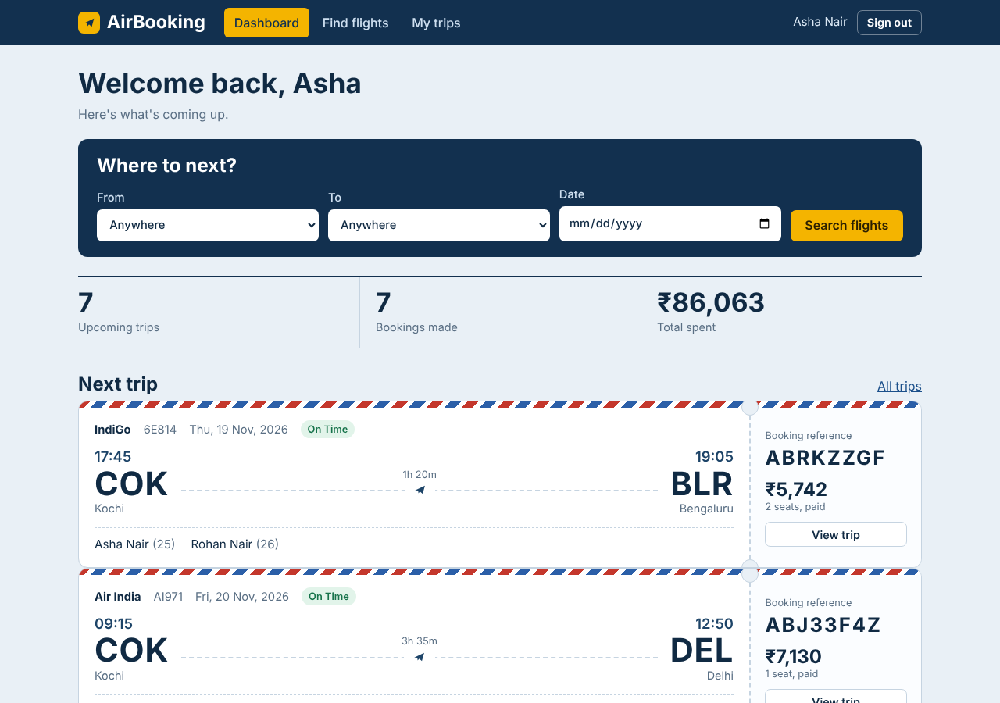 |

## Known limitations
- Payment is a simulation by design. SQLite is used for easy setup; use PostgreSQL in production.
- Seeded flights are fictional; live tracking needs a real flight number (AirLabs) or ICAO24 (OpenSky), and the sandbox I built this in could not reach those providers, so that path is covered by graceful-fallback tests only.
